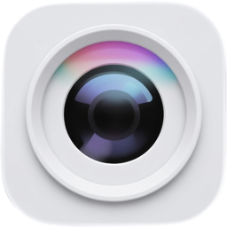
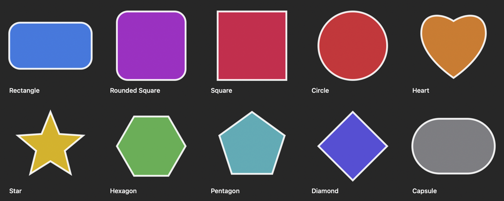

<p align="center">
  
</p>

<h1 align="center">Floating Camera</h1>

<p align="center">A small, native macOS menu bar app that keeps your camera floating above everything else.</p>

<p align="center">macOS 14+ · Swift + AppKit · No dependencies · MIT</p>



## Features

- **10 shapes**: Rectangle, Rounded Square, Square, Circle, Heart, Star, Hexagon, Pentagon, Diamond, Capsule.
- **Size slider** from 160 to 800 pt, keeping the selected shape's aspect ratio.
- **Zoom** the image inside the shape from 100% to 300%.
- **English or Spanish UI**, following macOS by default.
- **Border** width/color, **opacity**, and **rounding**.
- **Camera** selection, **480p / 720p / 1080p** capture (720p by default), and **15/24/30/60 fps** (30 fps by default).
- **Mirror**, **Always on Top**, all Spaces, and full-screen support.
- Drag to move; **Reset Position** centers the overlay on the current screen.
- **Hide/Show** with `⌃⌥H`. The menu bar icon changes, the camera indicator turns off, and CPU drops to zero.
- **Auto-update** from GitHub Releases. The app checks once every 30 days on launch and also has a manual **Check for Updates…** menu item.
- Menu bar only: no Dock icon, no windows in the app switcher.

## Requirements

- macOS 14.0 or later.
- A camera (built-in, external, Continuity Camera, or Desk View).
- To build: Xcode Command Line Tools (`xcode-select --install`). Xcode is not required.

## Install

```bash
git clone <repository-url>
cd floating-cam
chmod +x build.sh
./build.sh
open build/FloatingCamera.app
```

Install to `/Applications` and launch:

```bash
./build.sh --install
```

Build a universal binary:

```bash
./build.sh --universal
```

The local build is ad-hoc signed. macOS may show a Gatekeeper warning on another Mac. Right-click the app and choose **Open**, or remove the quarantine attribute:

```bash
xattr -dr com.apple.quarantine /Applications/FloatingCamera.app
```

## Usage

Allow camera access on first launch. Click the aperture icon in the menu bar.

| Menu | Action |
| --- | --- |
| Camera ▸ | Choose the active camera. |
| Shape ▸ | Choose one of ten shapes. |
| Border ▸ | Width and color. |
| Size | Resize the overlay from 160 to 800 pt. |
| Opacity | Overlay opacity, 10–100%. |
| Rounding | Rounds Rectangle and Rounded Square. Shown only for those shapes. |
| Zoom | Digital crop of the camera image, 100–300%. |
| Advanced ▸ | Resolution, Frame Rate, Mirror, Always on Top, Reset Position, Check for Updates and Language. |
| Hide / Show Camera | Toggles the overlay and stops/restarts the camera session. |
| Quit | Quit the app. |

Resolution and Frame Rate fall back to the closest preset supported by the camera. **Language** can be System (default), English or Español; System follows the macOS language.

Drag inside the overlay to move it. Use the **Size** slider to resize; the overlay keeps the selected shape's aspect ratio. The app does not steal focus until you click the overlay.

### Resolution and performance

Resolution and frame rate change the camera capture settings. They mainly affect camera bandwidth, GPU/memory use, heat, and image quality; CPU can look similar because the preview is hardware-accelerated. In a sample run on a MacBook Air, CPU stayed around 5–9% at 480p, 720p, and 1080p, and at both 15 and 30 fps, with roughly 145 MB of memory. The big saving is **hiding** the camera: the capture session stops completely and CPU drops to 0%.

- **480p**: lowest camera load.
- **720p**: recommended balance (default).
- **1080p**: best quality, highest camera/GPU load.

## Updates and releases

The app checks `https://api.github.com/repos/<owner>/<repo>/releases/latest` once every 30 days on launch. If a newer version exists, it offers to download and install it, then relaunches. The updater verifies the bundle identifier and version, installs over the current app, removes the download quarantine attribute, and relaunches. If the app folder is not writable, it opens the release page instead.

GitHub Actions builds the app on every push/PR and creates a release when a `v*` tag is pushed. The build injects the repository metadata into `Info.plist`, so CI-built apps update from their own release feed.

To publish a release:

1. Bump `CFBundleShortVersionString` in `Info.plist`.
2. Commit, then push a matching tag:

```bash
git tag v1.0.1
git push origin v1.0.1
```

The workflow verifies that the tag and `Info.plist` version match, builds a universal app, packages `FloatingCamera.zip`, and creates the GitHub Release.

For a local build with updates enabled:

```bash
GITHUB_REPOSITORY=owner/floating-cam ./build.sh --universal
```

Without repository metadata, auto-update is disabled. The manual check will explain this. The build script reads the GitHub `origin` remote automatically when present; CI injects the repository. Because the app is ad-hoc signed, a rebuilt/updated app may ask for camera permission again.

## Troubleshooting

- **Camera does not start**: System Settings → Privacy & Security → Camera, enable Floating Camera, then reopen the app.
- **No cameras found**: Check that the camera is connected and not in use by another app. Continuity Camera can take a moment to appear.
- **Overlay behind a window**: Turn on **Always on Top**.
- **Hotkey does nothing**: Another app may own `⌃⌥H`; use the menu.
- **Gatekeeper blocks the app**: The build is ad-hoc signed. Right-click → Open, or use the quarantine command above.
- **Reset settings**: `defaults delete com.floatingcamera.app`

## Testing

```bash
./test.sh
```

The tests cover settings and migration, shape paths, aspect/size and screen geometry, localization, FPS/resolution mapping, version comparison, and GitHub release parsing. They run in CI on every push and pull request. UI, camera, and update-install behaviour still need a manual smoke test.

## Contributing

Keep it KISS and DRY: native Swift/AppKit, no third-party dependencies, camera work off the main thread, UI on the main thread. Run `./test.sh` and test shapes, size, camera switching, hide/show, multi-monitor, and Always on Top before submitting.

## License

MIT. See [LICENSE](LICENSE). Based on the original Floating Camera by Tomás Menezes (@tomasmenezes), also MIT. The app icon is from that project.
