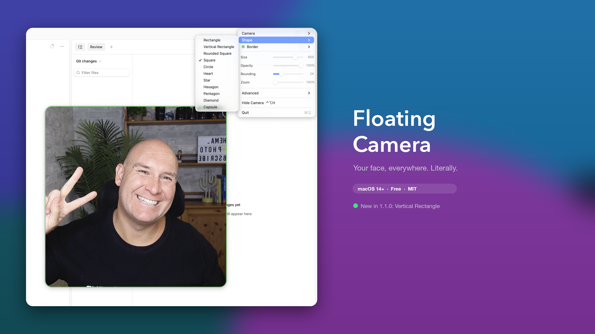
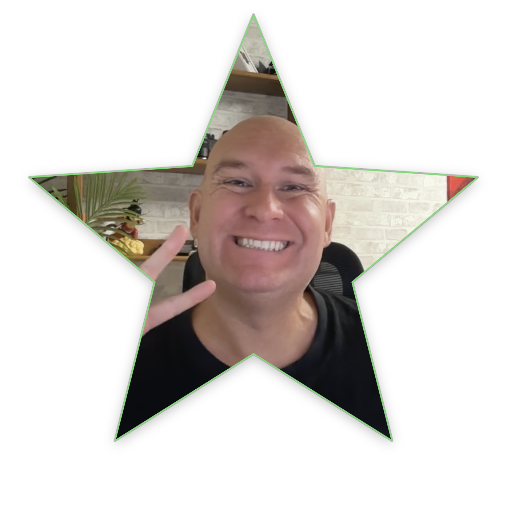

# I Got Tired of My Face Being Stuck in a Box, So I Built Floating Camera

Okay, real talk: how many hours a day is your face trapped in a tiny rectangle in the corner of a Zoom call? For me it was… a lot. And every "floating webcam" tool I tried was either a bloated Electron monster eating half my RAM, a sketchy subscription app, or just plain ugly.

So I built the thing I actually wanted. It's called **Floating Camera**, it's native macOS, it's free, it's open source — and yes, that's really it running on my Mac above. Let's get into it.



## What even is this?

It's stupid simple, and that's the whole point. Floating Camera puts a little live preview of your camera **on top of everything else** on your Mac. No Dock icon. No window lost behind seventeen Chrome tabs. Just your beautiful face, floating over your editor while you present, teach, stream, or pretend to pay attention in standup.

It lives in the menu bar. You click the little aperture icon, pick your options, and get on with your life. Everything lives in that one menu: camera picker, shape, border, sliders for size / opacity / rounding / zoom, and an Advanced section with resolution, frame rate, mirror, always-on-top, and language. That's the entire user manual. Well, almost — keep reading.

## The important stuff (yes, there's actual engineering in here)

Under the hood it's 100% native Swift and AppKit — **zero dependencies**, zero Electron, zero nonsense. The camera runs on a background thread, the preview is hardware-accelerated through AVFoundation, and it sips CPU (like 5–9% on a MacBook Air). And here's my favorite part: when you hit **Hide Camera** (`⌃⌥H` from anywhere), it doesn't just hide the window — it **kills the camera session completely**. Camera light off, CPU to zero. Your laptop fans can finally shut up.

The stuff that matters day to day:

- **Camera picker** with 480p / 720p / 1080p and 15–60 fps, with graceful fallback if your camera doesn't support your pick
- **Size slider** (160–800 pt) that keeps the shape's aspect ratio, **zoom** (100–300%) to crop inside the frame
- **Mirror toggle**, **Always on Top**, works across Spaces and in full-screen apps
- **Right-click the overlay** for quick Hide / Reset Position / Quit — it even steals focus politely to make the menu work
- **Auto-updates** from GitHub Releases (checks once every 30 days, no nagging, no telemetry, no account, no phone-home anything)
- **English or Spanish UI**, follows your system language by default

The whole settings model is a tiny JSON blob in UserDefaults. Old settings files still load fine when new versions add stuff. Boring, reliable, the way I like it.

## Oh, and it does shapes

Look — the shapes are not the point of this app. The point is a camera bubble that stays out of your way and behaves. But could I resist adding a heart and a star? Absolutely not.



There are **11 shapes**: Rectangle, Vertical Rectangle, Rounded Square, Square, Circle, Heart, Star, Hexagon, Pentagon, Diamond, and Capsule. The newest one is the **Vertical Rectangle (9:16)** — it crops the sides of your feed for that tall phone-video look, perfect if you record vertical content. It supports rounded corners too, obviously.

Do I attend meetings as a floating star? That's between me and HR.

## Get it

It's free and MIT-licensed. Grab the latest `FloatingCamera.zip` from the [releases page](https://github.com/neo22s/floating-cam/releases), unzip, drag to `/Applications`, allow camera access when macOS asks, and you're floating.

```bash
git clone https://github.com/neo22s/floating-cam.git
cd floating-cam
./build.sh --universal
./test.sh
```

That's it. No package manager drama, no 2GB `node_modules`. Just `swiftc` and vibes.

## What's next?

Honestly? Whatever annoys me first. The vertical rectangle shape came from wanting better vertical-video framing, so the roadmap is basically "things that bug me during real calls." Got an idea — a hotkey, a feature, a shape you can't live without? Open an issue or send a PR. The codebase is small on purpose; you can read the whole thing on a lunch break.

Now if you'll excuse me, I have a meeting to attend as a floating hexagon.
